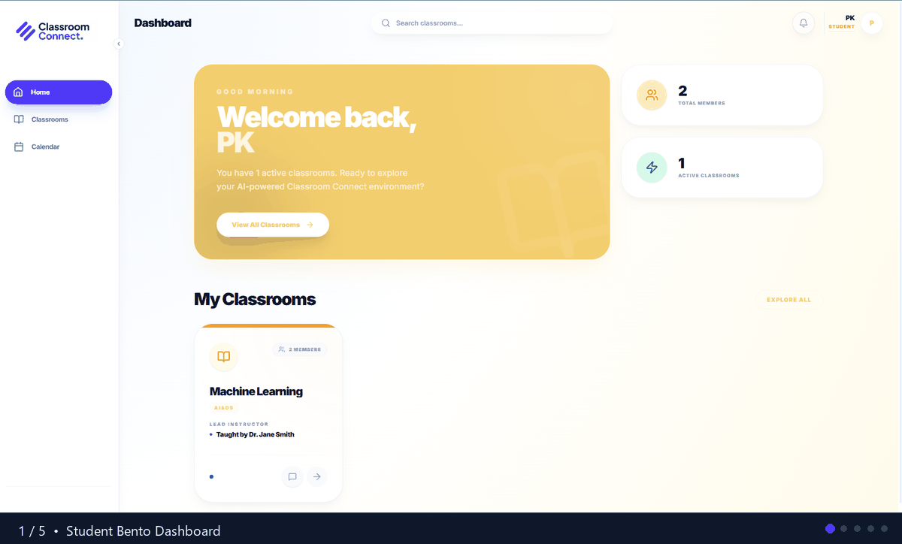

# 🎓 UniFlow — The AI-Powered Academic Hub

> **Status**: 🚀 Fully Operational. *From static PDFs to interactive knowledge in seconds.*  
> 🔗 **Live Demo**: [**uni-flow-seven.vercel.app**](https://uni-flow-seven.vercel.app/)

---

## ✨ Experience Modern Academic AI
UniFlow is a premium, bento-style classroom platform designed to turn your study materials into a living, breathing knowledge base. It bridges the gap between static files and deep understanding using the latest in **Google Gemini AI** and **LaTeX-ready** math rendering.

<p align="center">
  <a href="https://uni-flow-seven.vercel.app/" target="_blank">
    
  </a>
</p>

---

## 🌟 Premium Features

### 🧠 AI-Powered Study Assistant
Not just a chatbot, but a specialized tutor for your classroom.
- **KaTeX Professional Math**: Beautiful, human-readable math notation ($\sigma(z)$ vs `$$\sigma(z)$$`).
- **Contextual Ingestion**: AI "reads" your PDFs and images to provide exact page citations.
- **Recent Material Awareness**: Deep integration with MongoDB to prioritize your latest uploads.

### 🍱 Bento-Style Dashboard
A stunning, glassmorphic interface that puts your learning first.
- **Classroom Cards**: Quick access to your academic hubs with instructor visibility.
- **Glassmorphic UI**: Sophisticated blur effects and a lightweight, premium feel.
- **Confetti Celebrations**: Modern micro-interactions for successful uploads and actions.

### ⚙️ High-Performance Engine
Built on a "state-of-the-art" technical foundation:
- **FastAPI Backend**: Rapid, asynchronous Python API with Server-Sent Events (SSE) token streaming.
- **Celery Worker Ingestion**: Non-blocking background file processing and multimodal extraction.
- **Vector Search Engine**: MongoDB Atlas Vector Search (`$vectorSearch` in cloud) / ChromaDB (local dev).
- **Google Gemini 2.5 AI**: Multi-key pool rotation for zero rate-limit interruptions.
- **Cloudinary CDN**: Persistent media delivery for seamless global student access.

---

## 🏗️ Technical Stack

| Layer | Technologies |
| :--- | :--- |
| **Frontend** | Next.js 15+ (App Router), React 19, Tailwind CSS 4, Framer Motion, Vercel Edge |
| **Backend** | FastAPI, Python 3.11+, Celery, Starlette WebSockets |
| **AI / Agentic RAG** | Google Gemini 2.5 Flash, LangGraph v2, KaTeX Math Rendering |
| **Vector Search** | MongoDB Atlas Vector Search (Production) / ChromaDB (Local Dev) |
| **Database & Cache** | MongoDB Atlas (Cloud NoSQL), Upstash Redis (TLS Broker, Caching & Pub/Sub) |
| **Media & Storage** | Cloudinary CDN (Persistent Files), Container-Local Ephemeral Disk Cache |

---

## 🚀 Quick Start

### 🔧 Prerequisites
- **Node.js** (v20+)
- **Python** (v3.10+)
- **MongoDB** & **Redis** (Local or Cloud)
- **Google Gemini API Key**

### 💻 Local Development

1. **Backend Setup**:
   ```bash
   cd backend
   pip install -r requirements.txt
   # Setup .env with Gemini/Mongo keys
   python run.py
   ```

2. **Frontend Setup**:
   ```bash
   cd frontend
   npm install
   npm run dev
   ```

3. **Background Workers**:
   ```bash
   cd backend
   celery -A core.worker worker --loglevel=info
   ```

---

## Summary
UniFlow is more than a classroom hub; it’s an **intelligent ecosystem** for students and teachers. It combines a premium user experience with powerful AI automation to make learning more efficient, interactive, and visually stunning.
